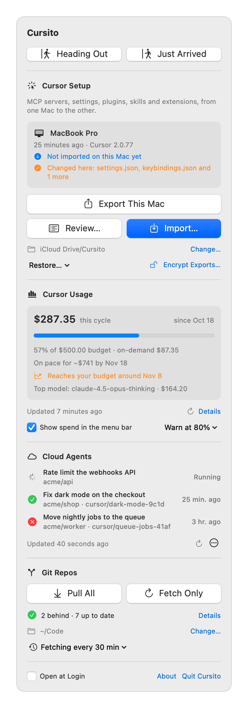

<h1 align="center">Cursito</h1>

<p align="center">
  <a href="#install"></a>
  <a href="Package.swift"></a>
  <a href="https://github.com/OrbeApp/cursito/releases/latest"></a>
  <a href="https://github.com/OrbeApp/cursito/actions/workflows/ci.yml"></a>
  <a href="LICENSE"></a>
</p>

<p align="center">
  <picture>
    <source media="(prefers-color-scheme: dark)" srcset="docs/screenshot-dark.png">
    
  </picture>
</p>

Cursor has no built-in settings sync. Cursito is a small macOS menu bar app that
copies your Cursor setup from one Mac to another through iCloud Drive (or any
folder both Macs can see).

- **Export This Mac** on your main Mac writes the setup to a single
  `cursor-sync.tar.gz`.
- On the other Mac, the menu bar icon fills in and a notification arrives when
  there's an export it hasn't imported. **Review…** shows what would change,
  including MCP servers that won't start there, and **Import…** applies it: it
  quits Cursor, backs up the current setup, imports and reopens Cursor.
- **Restore…** rolls back any of the last five imports, or imports one of the
  last three exports a newer one replaced (kept in `previous-exports/` in the
  sync folder), so overwriting an export by mistake isn't final either.
- While it exports or imports, the menu bar icon turns into an up or down
  arrow, and a notification tells you when it's done if the menu is closed.
- When you change settings, rules, skills, MCP servers, plugins or extensions
  after this Mac's last export or import, the menu says what changed
  ("Changed here: settings.json, .codex/skills/") and the icon gets a circle,
  so a change doesn't stay behind on one Mac.

Sync goes one way: the Mac that exports last is the source of truth. Cursito
warns you before overwriting an export the other Mac hasn't imported yet, and
before an import replaces changes this Mac hasn't exported. With both at once,
the icon shows an exclamation mark.

**Heading Out** and **Just Arrived** do the whole switch in one click.
Heading Out fetches your repos, exports this Mac and lists the work that only
lives here: uncommitted changes, unpushed commits, branches without an
upstream. Just Arrived imports the other Mac's setup if there's a new one and
pulls every repo.

**Cursor Usage** shows what you've spent in the current billing cycle and how
close you are to your on-demand limit. **Details** breaks it down by model, by
day and by agent conversation, and lists every team member's spend. It reads
Cursor's
[Admin API](https://cursor.com/docs/account/teams/admin-api), so it needs an
Enterprise team and an admin key (see [Cursor Usage](#cursor-usage)).

**Cloud Agents** lists your running and recently finished Cursor cloud
agents and sends a notification when one finishes or fails. It needs a user
API key (see [Cloud Agents](#cloud-agents)).

As an extra, **Git Repos** keeps the code itself in step: point it at the
folder that holds your repos and **Pull All** fetches every repo and
fast-forwards the ones that are behind. It never merges or rebases; repos with
uncommitted changes or diverged branches are listed for you to sort out
(right-click one to open it in Finder, Terminal or Cursor). **Fetch Only**
just updates the remote branches. **Fetch in the Background…** does that every
15 minutes, 30 minutes or hour, and sends a notification when a repo gets new
commits on its remote (once per repo until you pull it).

## What gets synced

| Synced | Where it lives |
|---|---|
| MCP servers | `~/.cursor/mcp.json` |
| Hooks | `~/.cursor/hooks.json` |
| Agent/CLI settings (permissions, models…) | `~/.cursor/cli-config.json`, minus the login session |
| Editor settings, keybindings, snippets | `~/Library/Application Support/Cursor/User/` |
| Plugins | `~/.cursor/plugins` plus the installed plugin list in Cursor's `state.vscdb` |
| Skills and subagents | `~/.cursor/{skills,agents,commands,rules}`, `~/.agents/skills`, `~/.claude/skills`, `~/.codex/skills` |
| Extensions | Installs missing ones with the `cursor` CLI; never uninstalls |

Not synced:

- **Chats, login and MCP OAuth tokens.** They're encrypted with each Mac's
  keychain, so OAuth MCP servers ask you to log in again after an import.
- **User Rules.** Cursor already syncs them with your account.

An import mirrors the export: skills or plugins that exist only on the importing
Mac are removed. The previous state stays in `~/.cursito/backups/`.

**Review…** also checks the exported MCP servers against this Mac: it flags
servers whose command (`npx`, `uvx`, an absolute path…) isn't installed, remote
servers that may ask you to log in because OAuth tokens aren't synced, and
`localhost` servers that need their app running. It looks in the usual install
folders (Homebrew, nvm, bun, cargo, `~/.local/bin`…), not in your shell's
`PATH`, so a command installed somewhere unusual can show up as missing.

## Install

Requires macOS 14 or later, on each Mac.

**Download:** get `Cursito.zip` from the
[latest release](https://github.com/OrbeApp/cursito/releases/latest), unzip it
and move `Cursito.app` to `/Applications`. The build isn't notarized yet, so
the first time right-click the app and choose **Open** (or run
`xattr -dr com.apple.quarantine /Applications/Cursito.app`).

**Build from source** with Xcode or the Command Line Tools (Swift 6), which
avoids that warning:

```bash
git clone https://github.com/OrbeApp/cursito.git
cd cursito
scripts/build-app.sh --install    # builds and copies Cursito.app to /Applications
```

Open Cursito from `/Applications`. The first time it touches iCloud Drive,
macOS asks for permission. Turn on **Open at Login** in the menu so it's always
there.

Cursito checks [GitHub releases](https://github.com/OrbeApp/cursito/releases)
at launch and once a day. When there's a newer one, **Update to X.Y.Z**
appears next to the title and opens the release page. To update a build from
source, `git pull` and run `scripts/build-app.sh --install` again.

The default sync folder is `iCloud Drive/Cursito`. Use **Change…** in the menu
to pick another one; both Macs need to point at the same folder.

## Cursor Usage

1. In the [Cursor dashboard](https://cursor.com/dashboard), a team admin opens
   **API Keys** and creates a key (`crsr_…`).
2. In Cursito, **Connect Admin API Key…**, paste it and check the email. It
   defaults to the account Cursor is signed in with on this Mac.

Cursito checks the key against the API before saving it in your login
keychain, never in its preferences or on disk. It only calls
`/teams/spend` and `/teams/filtered-usage-events`, but the key itself has
admin rights over the team, so treat it like a password. **Settings… →
Disconnect** in the Details window removes it.

**Show spend in the menu bar** puts this cycle's spend next to the icon.

From the third day of the cycle, the menu shows where spend ends up at the
cycle's average daily pace ("On pace for ~$6,984 by Nov 8") and, with a limit
or budget, the day that pace reaches it. With notifications on, Cursito sends
that once per cycle, before the threshold warning.

The warning measures spend against your per-user on-demand limit in Cursor
or, if you have none, against a **monthly budget** you set in Cursito (it
counts everything spent in the cycle, included usage too). Once spend
reaches 80% of it, the icon turns into a gauge with the percentage, and into
a warning sign past 100%, whether or not the spend is shown. The menu next to
the checkbox sets the budget, changes the threshold (50–100%, or never) and
can send a macOS notification: once when you cross the threshold and once
more past 100%, per billing cycle. Notifications need the built app; they're
off under `swift run`.

Cursor aggregates usage hourly, so Cursito refreshes at most once an hour in
the background; the refresh button forces it. Costs are what Cursor
counts towards spend (`chargedCents`), included usage and on-demand alike.

**Sessions** groups requests by agent conversation, most expensive first, with
the model that cost the most in each. Right-click one to copy its conversation
ID. Requests outside a conversation (Tab, Cmd+K…) are counted in the total
below the table.

The Admin API is Cursor's only documented way to read usage. Apps that read
the session of the Cursor app itself stopped working when Cursor started
encrypting it with the keychain, and Cursito doesn't try to get around that.

## Cloud Agents

1. In the [Cursor dashboard](https://cursor.com/dashboard), create a user
   API key (Integrations › API Keys). The Admin API key from Cursor Usage
   doesn't work here.
2. In Cursito, **Connect Cursor API Key…** and paste it.

The menu then shows the agents running now (up to three) and the ones that
ended in the last 24 hours, with the repo, the branch they pushed and how they
ended. Click one to open it in Cursor, or its pull request once it's done.
With **Notify When an Agent Finishes** (on by default, in the `…` menu),
Cursito sends a notification when a run finishes or fails, with the repo,
branch and PR. **Heading Out** also mentions the agents still running.

Cursito checks the key with `GET /v1/me` and keeps it in your login keychain.
The key could launch agents, which costs money, but Cursito's client only
sends GET requests to `/v1/me`, `/v1/agents`, `/v1/agents/{id}` and
`/v1/agents/{id}/runs/{runId}`: it can't start, follow up, stop or delete an
agent. It refreshes every minute while an agent runs, every 5 minutes
otherwise and when you open the menu, and waits as long as Cursor asks when
it rate limits. **API Key…** in the same menu replaces or disconnects it.

The [Cloud Agents API](https://cursor.com/docs/cloud-agent/api/endpoints) is
in public beta, so it may change under Cursito.

## Command line

The app is a thin UI over [`scripts/sync-cursor.sh`](scripts/sync-cursor.sh),
which also works on its own:

```bash
SYNC=~/Library/Mobile\ Documents/com~apple~CloudDocs/Cursito/cursor-sync.tar.gz

scripts/sync-cursor.sh export -d "$SYNC"   # main Mac
scripts/sync-cursor.sh info   -d "$SYNC"   # who exported, and whether this Mac imported it
scripts/sync-cursor.sh diff   -d "$SYNC"   # what an import would change
scripts/sync-cursor.sh import -d "$SYNC"   # other Mac, with Cursor closed
scripts/sync-cursor.sh import -d ~/.cursito/backups/20261029-105854   # restore a backup
scripts/sync-cursor.sh verify -d "$SYNC"   # can this Mac read (and decrypt) the export?
scripts/sync-cursor.sh status              # what changed here since this Mac's last export or import
```

Run `scripts/sync-cursor.sh -h` for every option. A `-d` path ending in
`.tar.gz` is used as a single archive; any other path as a plain folder.
Exporting to an archive keeps the one it replaces in `previous-exports/`
(last three, named `<date> <host>.tar.gz`); import one with `-d` to undo an
export. Folder exports aren't kept.
With `CURSITO_PASSPHRASE` in the environment, `export` encrypts; reading an
encrypted export without it asks for the passphrase in a terminal, and exits
with status 3 otherwise or when it's wrong.

Git Repos runs [`scripts/update-repos.sh`](scripts/update-repos.sh):

```bash
scripts/update-repos.sh -C ~/code        # fetch + fast-forward every repo in ~/code
scripts/update-repos.sh -C ~/code -f     # fetch only
scripts/update-repos.sh -C ~/code api    # only ~/code/api
```

It runs git without a terminal, so remotes need credentials git can use on its
own: an SSH agent or keychain, or a credential helper for HTTPS. A repo that
would ask for a password shows up as `fetch failed`.

## Security

The export contains `mcp.json`, which often holds API tokens in plain text. The
archive is created with `600` permissions, but anything in iCloud Drive is only
end-to-end encrypted if you turn on
[Advanced Data Protection](https://support.apple.com/en-us/102651). Don't put
the sync folder in a git repository or a shared folder.

**Encrypt Exports…** (under the sync folder in the menu) encrypts everything
but a small manifest (who exported and when) with `openssl enc`: AES-256-CBC,
with the key derived from your passphrase by PBKDF2-SHA256 with 600,000
iterations and a random salt. Use the same passphrase on both Macs; Cursito
keeps it in each Mac's login keychain and passes it to the script through the
environment, never as an argument. When an encrypted export arrives on a Mac
that doesn't have the passphrase, Cursito asks for it before quitting Cursor.
This protects what's in the file, not its integrity: someone who can write to
your sync folder can still replace the export, as they could without
encryption. Forget the passphrase and the export can't be read; export again
from the other Mac with a new one.

## How it works

- Export copies the files above into a staging folder, strips the login session
  from `cli-config.json`, reads the installed plugin list from `state.vscdb`,
  records the Mac's hardware UUID and the time, and replaces the archive in one
  move, so the other Mac never sees a half-written export.
- Import refuses to run while Cursor is open, because Cursor rewrites its
  settings and state when it quits. The app quits Cursor for you and reopens it
  afterwards.
- Import keeps the importing Mac's login session in `cli-config.json`, only
  touches the `cursor.plugins.installedIds.*` keys in `state.vscdb`, and records
  the import in `~/.cursito/last-import`.
- After an export or an import, the script saves a SHA-256 of each synced item
  in `~/.cursito/last-sync` (the login session left out, extensions by id).
  `status` compares this Mac against it; it only reads local files, so Cursito
  runs it every couple of minutes. Changes are tracked from the first export or
  import with this version on.

Cursito relies on how Cursor stores its setup today, which isn't a public API.
If a Cursor update moves things around, an import may miss something; the
backup lets you roll back.

## Development

```bash
swift run Cursito          # run the app from the checkout (uses scripts/sync-cursor.sh)
swift test                 # parsing, import-state rules, the usage and cloud agents clients
scripts/test-sync.sh       # end-to-end export/import (plain and encrypted) between two fake home folders
scripts/test-update-repos.sh   # update-repos.sh against throwaway git repos
```

`scripts/test-sync.sh` stubs `ps` and `cursor`, so it never touches your real
Cursor setup.

### Releases

The update check compares `CFBundleShortVersionString` in
`Resources/Info.plist` with the tag of the latest published GitHub release
(drafts and prereleases don't count). To release:

1. On `develop`, bump `CFBundleShortVersionString` in `Info.plist` and turn
   `## [Unreleased]` in `CHANGELOG.md` into `## [X.Y.Z] - YYYY-MM-DD`.
2. Merge `develop` into `main` with a merge commit, tag the merge `vX.Y.Z` and
   push the tag.
3. The Release workflow checks the tag matches `Info.plist`, runs the tests,
   builds `Cursito.zip` and publishes the release with that version's
   CHANGELOG section (`scripts/release-notes.sh X.Y.Z` prints it locally).

### Signed releases

`scripts/build-app.sh` signs ad hoc by default, which is enough for Macs you
build on yourself. To publish a download that opens without Gatekeeper
warnings, sign with a Developer ID and notarize:

```bash
CODESIGN_IDENTITY="Developer ID Application: Your Name (TEAMID)" scripts/build-app.sh --zip
xcrun notarytool submit build/Cursito.zip --keychain-profile <profile> --wait
xcrun stapler staple build/Cursito.app
```

## License

[MIT](LICENSE). Cursito isn't affiliated with Anysphere or Cursor.
